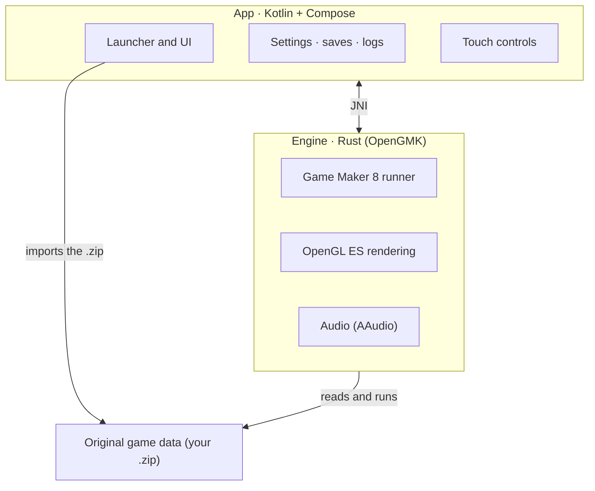

# Pokémon Reloaded on Android

Run **Pokémon Reloaded** on Android without a Windows emulator in the way. This is the English
edition of the community port originally maintained by [@Klisee](https://github.com/Klisee); the
upstream project lives at
[Klisee/pokemon-reloaded-android](https://github.com/Klisee/pokemon-reloaded-android).

## What this actually is

Calling it a "port" is a bit of a stretch, and it's worth clarifying. Pokémon Reloaded is a game made
in Game Maker 8 for Windows, and **nothing here has been rewritten or recompiled**. What this app
does is **run the original game as-is**, with its files untouched, on top of
[OpenGMK](https://github.com/OpenGMK/OpenGMK): a native Rust reimplementation of the Game Maker 8
engine.

In other words: there's no Wine, no emulated Windows, no translation layer. The engine is written for
Android and compiled for the phone, so the game runs practically like a native app. The only thing
that's been "ported" is the engine's internals, not the game.

The app does provide everything around the game: importing the game from a `.zip`, touch controls,
settings, save management, and logs. The game itself is left untouched.

## How it works

- **Import.** Tap Import and choose the game's `.zip`. The app unpacks it into its own private
  storage, so it doesn't depend on storage permissions or where you keep the file.
- **Run.** The engine (OpenGMK, in Rust) loads as a native library and starts the Game Maker 8 runner
  on the game's data. Rendering goes through OpenGL ES and audio through AAudio.
- **Controls.** The touch layer isn't fixed: it changes with the game's state, so on the map you get a
  d-pad and in menus something else. Each button presses a game key, and you can remap any of them in
  Settings → Controller → Controls. A real controller also works, detected automatically.
- **Saves.** They're read and written in the game's folder. From Settings → Saves you can view them,
  export, import, delete, and move one from one slot to another. If you played on PC, your save comes
  in here.
- **Leave and return.** When the app goes to the background, the loop stops and the audio really cuts
  out; when you come back, it picks up where it was instead of going black.
- **Logs.** If something goes wrong, the app writes a log and you can share it as a text file from
  Settings → Logs, without losing it when the phone restarts.

## How it's put together



The app and the engine are two separate worlds that talk over JNI. The engine knows nothing about
Android or the UI: it only knows how to run the game. The app knows nothing about Game Maker: it just
launches and wraps it. That separation is what lets you touch the UI without breaking the engine, and
vice versa.

## What you need

The original game files, which are on **F3R**'s blog:
[pokemon-reloaded.blogspot.com](https://pokemon-reloaded.blogspot.com/)

The repo doesn't include any game assets, and that's exactly what keeps it clean.

## How to use it

1. Install the APK from the latest release.
2. Get the game as a `.zip` and tap **Import** (or use **Download** to open the blog).
3. **Play**. If you already had a save on PC, bring it in from Settings → Saves.

## Status

It's in beta and it shows: it can crash. If something fails, save a log from Settings → Logs and open
it as an issue.

What's currently giving trouble, to be resolved later:

- **Battle scaling.** The game changes the scale on its own and the camera goes haywire.
- **The Fly move.** In battle it doesn't connect and the Pokémon keeps falling.

And a loose to-do list, in no order:

- Polish battle scaling until it behaves.
- More performance tuning on modest phones.
- Review compatibility with all kinds of controllers.

## Building

```
# The engine (Rust) and its .so for Android
cd src/OpenGMK
cargo ndk -t arm64-v8a --platform 29 build -p gm8emulator --release

# The app
cd ../../android
./build.sh :app:assembleRelease
```

## Credits

- **Pokémon Reloaded** is the work of **F3R Productions**: [the game's blog](https://pokemon-reloaded.blogspot.com/)
- **OpenGMK**, the engine reimplementation without which this wouldn't exist: [github.com/OpenGMK/OpenGMK](https://github.com/OpenGMK/OpenGMK)
- **Original Android port** by [@Klisee](https://github.com/Klisee): [Klisee/pokemon-reloaded-android](https://github.com/Klisee/pokemon-reloaded-android)
- **Google Sans Flex**, the app's typeface

Pokémon is a trademark of Nintendo, Game Freak, and Creatures. This project is not affiliated with or
endorsed by them.
